  

# 🚀 Awesome Front-End UI Test Automation

> 🌟 A curated list of awesome **Front-End UI Test Automation** frameworks, tools, libraries, and cloud platforms for cross-browser, component, and end-to-end (E2E) testing.

  
  
  
  
  
  

**Front-End UI Test Automation** accelerates continuous delivery and ensures mission-critical web applications perform reliably across browser engines, viewports, and operating systems. This guide tracks **open-source frameworks**, **cloud-hosted SaaS test grids**, and **AI-driven testing engines** for developer-friendly, zero-flake test pipelines. 🎯

---

## 📑 Table of Contents

- [🌐 Overview](#-overview)
- [📈 Sector Overview & Market Dynamics](#-sector-overview--market-dynamics)
- [☁️ Cloud Testing Grids & SaaS Platforms](#saas-products)
- [💻 Open-Source UI Test Automation Frameworks](#-open-source-ui-test-automation-frameworks)
- [🤖 Specialized & Agentic Testing Tools](#-specialized--agentic-testing-tools)
- [⚖️ Framework Comparison Matrix](#️-framework-comparison-matrix)
- [🤝 How to Contribute](#-how-to-contribute)
- [💖 Support & Sponsorship](#-support--sponsorship)
- [📊 Star History](#-star-history)
- [⚠️ Disclaimer & Best Practices](#️-disclaimer--best-practices)

---

## 🌐 Overview

Modern front-end test automation spans multiple tiers of verification:
- 🧪 **End-to-End (E2E) Browser Testing**: Simulating genuine user workflows across Chromium, Firefox, and WebKit rendering engines.
- 🎨 **Component & Visual Regression Testing**: Isolating design system components and catching unintentional layout shifts or pixel defects.
- 📱 **Cross-Browser & Real-Device Testing**: Orchestrating massive test concurrency across diverse OS environments, desktop browsers, and real mobile hardware.

---

## 📈 Sector Overview & Market Dynamics

The global automated testing market is estimated at **$34B to $48B** (scaling toward **$90B+ by the early 2030s** at an ~8–10% CAGR), with cloud-based web and mobile automation comprising over **$28B** of that expenditure. 

The industry demonstrates **moderate fragmentation with concentrated enterprise leadership**: while specialized AI startups and open-source ecosystems (e.g., Playwright, Selenium) proliferate rapidly, high-scale execution infrastructure remains consolidated around a handful of multi-billion-dollar enterprise grid providers (such as Tricentis and BrowserStack) that dominate enterprise compliance and large-scale hardware device farms.

---

## ☁️ Cloud Testing Grids & SaaS Platforms

The table below catalogs notable commercial SaaS platforms and hosted cloud test execution infrastructure, sorted in descending order by company scale (valuation / annual revenue).

| Product | Company Size (Valuation / Revenue) | Description | Pricing (Starting) | Free Tier / Trial Limits |
|---|---|---|---|---|
| **[Sauce Labs](https://saucelabs.com/)** | **$4.5B** valuation *(Parent: Tricentis; $400M+ ARR)* | Enterprise continuous testing cloud providing automated and live cross-browser testing across desktop browsers and real device clouds. | **$39/month** *(Live manual testing, billed annually)*; **$149/month** *(Virtual device automation, billed annually)* | **No permanent free tier**; Offers custom sales-assisted proof-of-concept / free trial upon request (Free unlimited open-source tier available) |
| **[Testim](https://www.testim.io/)** | **$4.5B** valuation *(Parent: Tricentis; $400M+ ARR)* | AI-powered low-code UI test automation utilizing self-healing Smart Locators to adapt to application DOM modifications and reduce flaky tests. | **$450/month** *(Historical entry estimate; modern plans quote-based per parallel concurrency)* | **Free Community Plan** *(Forever free with limited local/serial execution runs and single-seat basic capabilities; paid plans offer 14-day trial)* |
| **[BrowserStack](https://www.browserstack.com/)** | **$4.0B** valuation *(~$300M–$330M ARR)* | Market-leading cloud testing grid with 3,000+ real desktop browsers and mobile devices. Integrates Selenium, Playwright, Cypress, and Puppeteer. | **$59/month** *(Automate Chrome Desktop, 1 parallel session, billed annually)*; **$99/month** *(All Desktop Browsers, billed annually)* | **No permanent free automation tier**; Free trial includes **100 minutes of automated testing** + **30 minutes of live interactive testing** |
| **[LambdaTest](https://www.lambdatest.com/)** *(TestMu AI)* | **~$450M** valuation *(~$30M–$50M ARR)* | High-speed cloud testing infrastructure featuring HyperExecute test orchestration, KaneAI autonomous agents, and cross-browser testing grids. | **$29/month** *(Headless Linux automation, billed annually)*; **$79/month** *(Desktop Web Automation, 1 parallel session, billed annually)* | **Free Tier Forever** includes **100 lifetime automation minutes** with **2 parallel sessions**, plus 60 min/month live interactive testing |
| **[Leapwork](https://www.leapwork.com/)** | **$312M** valuation *(~$35M–$58M ARR)* | Visual, no-code automation platform tailored for enterprise QA teams to automate end-to-end workflows across web, desktop, and packaged apps. | **~$1,833/month** *($22,000/year base enterprise contract billed annually)* | **No permanent free tier**; Offers a **14-to-30-day guided enterprise free trial / proof-of-concept** upon qualification |
| **[Katalon](https://katalon.com/)** | **~$150M–$250M** est. valuation *(~$36M–$62M ARR)* | Low-code and full-code test authoring IDE and cloud platform for web, mobile, API, and desktop test management and CI orchestration. | **$84/user/month** *(Studio Enterprise authoring, billed annually at $1,008/seat/year)* | **Free Studio Desktop Plan** *(Authoring & local execution free forever with limited test suites; cloud/CLI runtime requires paid license; 30-day platform trial)* |
| **[Cypress Cloud](https://cloud.cypress.io/)** | **~$43M** funding valuation *(~$18M ARR)* | Enterprise test orchestration platform providing intelligent parallelization, Test Replay time-travel debugging, and flaky test management. | **$67/month** *(Team tier, up to 10,000 monthly test results, billed annually at $800/year)* | **Free Starter Plan Forever** includes **500 test results/month**, up to 50 team users, and community support |

---

## 💻 Open-Source UI Test Automation Frameworks

Top open-source repositories for self-hosted test runs, developer tooling, and headless browser automation, sorted in descending order by GitHub star count:

| Repository | GitHub Stars | Primary Engine / Focus | Description |
|---|---|---|---|
| **[Playwright](https://github.com/microsoft/playwright)** |  | Chromium, Firefox, WebKit | Unified, fast cross-browser automation with auto-waiting, network intercepting, mobile emulation, and built-in parallelism. |
| **[Puppeteer](https://github.com/puppeteer/puppeteer)** |  | Chromium, Chrome Headless | High-performance Node.js library maintained by the Google Chrome team for headless browser scripting, scraping, and PDF generation. |
| **[Cypress](https://github.com/cypress-io/cypress)** |  | Chromium, Firefox | Fast, developer-friendly front-end testing framework executing directly inside the browser for snappy DX and component testing. |
| **[Selenium WebDriver](https://github.com/SeleniumHQ/selenium)** |  | W3C Standard Drivers | Industry-standard browser automation protocol supporting Java, Python, C#, JavaScript, Ruby, and real Safari execution. |
| **[Appium](https://github.com/appium/appium)** |  | Cross-Platform (Mobile & Web) | Ecosystem-leading open-source automation framework for mobile web, native iOS/Android, and cross-platform desktop UI testing. |
| **[React Testing Library](https://github.com/testing-library/react-testing-library)** |  | React Component DOM | Simple and complete React DOM testing utilities that encourage accessible, user-centric testing practices over implementation details. |
| **[Nightwatch.js](https://github.com/nightwatchjs/nightwatch)** |  | W3C WebDriver & CDP | Easy-to-use Node.js end-to-end testing solution for web applications and browser components with built-in test runner. |
| **[TestCafe](https://github.com/DevExpress/testcafe)** |  | Proxy-based Driverless | Node.js tool to automate end-to-end web testing without WebDriver or external plugins; features smart assertion query retries. |
| **[WebdriverIO](https://github.com/webdriverio/webdriverio)** |  | WebDriver, BiDi & Appium | Next-gen browser and mobile test automation framework for Node.js, governed by the OpenJS Foundation with 70+ integrations. |
| **[DOM Testing Library](https://github.com/testing-library/dom-testing-library)** |  | DOM Query Utilities | Framework-agnostic UI querying and event simulation utilities driving the entire Testing Library ecosystem. |

---

## 🤖 Specialized & Agentic Testing Tools

| Project | GitHub Stars | Description |
|---|---|---|
| **[Playwright MCP](https://github.com/microsoft/playwright-mcp)** |  | Official Model Context Protocol (MCP) server enabling LLM coding agents to interact with browsers and automate test authoring. |
| **[Selenium Grid 4](https://github.com/SeleniumHQ/selenium)** |  | Scalable hub-and-node containerized test execution cluster featuring OpenTelemetry tracing and GraphQL cluster query endpoints. |
| **[Puppeteer Replay](https://github.com/puppeteer/replay)** |  | Library and CLI to replay and convert user flows recorded in the Chrome DevTools Recorder into automated test scripts. |

---

## ⚖️ Framework Comparison Matrix

| Feature / Capability | Playwright | Selenium WebDriver | Cypress | WebdriverIO |
|---|---|---|---|---|
| 🌐 **Supported Engines** | Chromium, Firefox, WebKit | Chrome, Firefox, Safari, Edge, etc. | Chromium, Firefox, WebKit (Exp) | Chromium, Firefox, Safari, Edge, Mobile |
| 💻 **Language Support** | JS/TS, Python, Java, C# | Java, Python, C#, JS, Ruby, Kotlin | JavaScript / TypeScript | JavaScript / TypeScript |
| ⚙️ **Execution Architecture** | BiDi / CDP / Custom Socket | W3C Standard (WebDriver / BiDi) | In-browser execution proxy | W3C WebDriver / BiDi |
| ⏱️ **Automatic Waiting** | Native & Built-in | Requires explicit/implicit waits | Native & Built-in | Native & Built-in |
| ⚡ **Parallel Execution** | Native & Free | Grid Hub/Node cluster | Paid (Cypress Cloud) / Plugins | Native worker pool |
| 🪟 **Multi-Tab / Multi-Window** | Native & Seamless | Native & Seamless | Limited / Workarounds | Native & Seamless |

---

## 🤝 How to Contribute

Contributions are warmly welcomed! Help keep this front-end UI test automation resource up to date:

1. 🍴 Fork this repository.
2. 📝 Add your recommended project, library, or platform to `README.md` in the appropriate category table.
3. 🔗 Include the name, official documentation link, GitHub star badge, and clear description.
4. 🚀 Submit a Pull Request with a short summary of the addition.

---

## 💖 Support & Sponsorship

Thank you for visiting and supporting **Awesome Front-End UI Test Automation**! 🎉

If this curation helped your team streamline test architecture, save CI costs, or pick the right framework, please consider:
- ⭐ **Starring this repository** to help others discover it.
- 🍴 **Forking and sharing** it with your developer and QA communities.
- ☕ **Buying a coffee or sponsoring the project** via the [GitHub Sponsor Dashboard](https://github.com/sponsors/ishandutta2007).

Your backing helps keep this guide rigorously researched and actively maintained!

---

## 📊 Star History

---

## ⚠️ Disclaimer & Best Practices

- 📌 This list is **community-curated** for educational and architectural reference; inclusion does not constitute commercial endorsement.
- 🔐 Ensure automated test suites follow security best practices: isolate test runner execution environments, safeguard credentials, and sanitize test data in CI/CD pipelines.

---

  <b>Made with ❤️ for QA automation engineers, SDETs, and front-end developers worldwide.</b>

